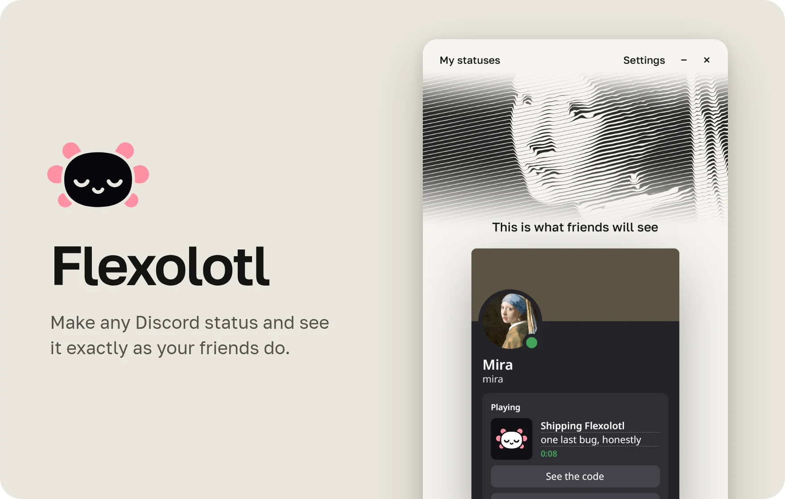
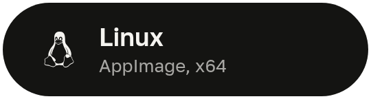
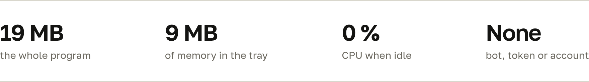
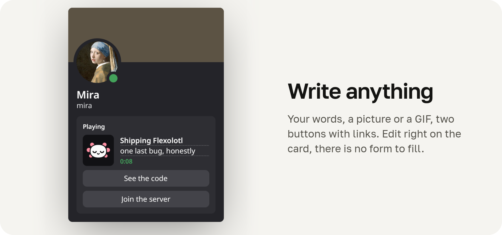
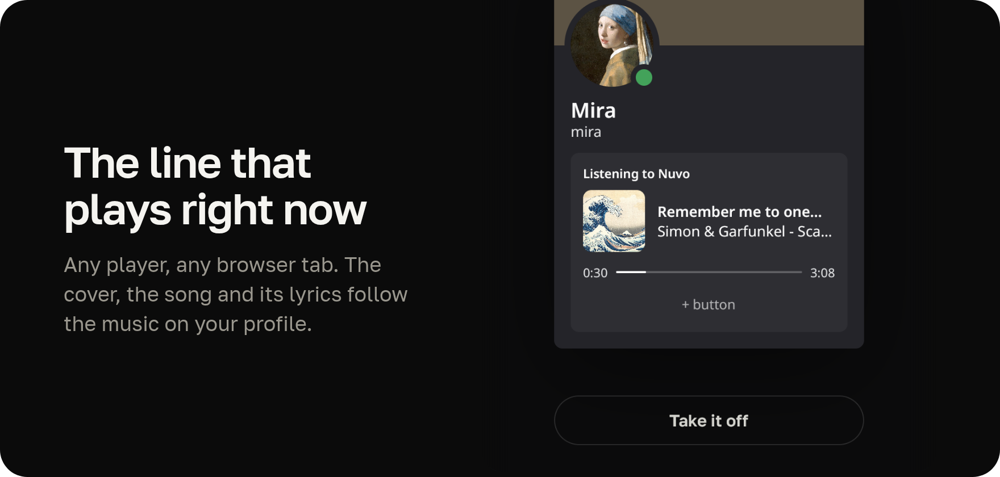
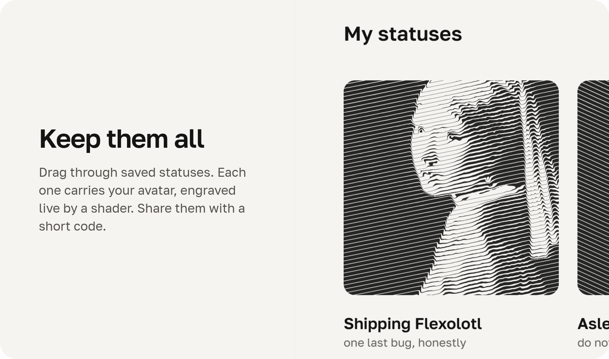

<p align="center">
  
</p>

<p align="center">
  <a href="https://github.com/Ziuziuk-Denys/Flexolotl/releases/latest"><picture><source media="(prefers-color-scheme: dark)" srcset=".github/assets/get-windows-dark.png"></picture></a>&nbsp;
  <a href="https://github.com/Ziuziuk-Denys/Flexolotl/releases/latest"><picture><source media="(prefers-color-scheme: dark)" srcset=".github/assets/get-macos-dark.png"></picture></a>&nbsp;
  <a href="https://github.com/Ziuziuk-Denys/Flexolotl/releases/latest"><picture><source media="(prefers-color-scheme: dark)" srcset=".github/assets/get-linux-dark.png"></picture></a>
</p>

<p align="center">
  <a href="https://github.com/Ziuziuk-Denys/Flexolotl/releases/latest"></a>
  <a href="https://github.com/Ziuziuk-Denys/Flexolotl/releases"></a>
  <a href="https://github.com/Ziuziuk-Denys/Flexolotl/actions/workflows/ci.yml"></a>
  <a href="LICENSE"></a>
</p>

Flexolotl is a small native app for your Discord status. The window is the profile card: whatever you see in it is what friends see on your profile. White means only you see it. Press one button, the window turns black, and now everyone does.

<p align="center"><picture><source media="(prefers-color-scheme: dark)" srcset=".github/assets/facts-dark.png"></picture></p>

<p align="center"></p>

<p align="center"></p>

<p align="center"></p>

## What it does

- **Any text.** Playing, listening, watching or competing, in your own words, with a timer if you want one.
- **Pictures and GIFs.** Paste a link or choose a file from your computer.
- **Two buttons** with your links, clickable on your profile.
- **Music and videos.** The song, the artist, the cover and the lyrics line by line, taken from the player that runs right now.
- **Your card, not a mock-up.** Your avatar, its decoration and the colours of the real Discord popout.
- **Stays out of the way.** Close the window and the status stays on, the axolotl waits in the tray.
- **Share codes.** One short line of text carries a whole status to a friend.
- English and Russian.

## Install

| | File | |
| - | - | - |
| **Windows** 10, 11 | `win-x64.exe`, `win-arm64.exe` | or the portable `.zip` |
| **macOS** 11 and later | `mac-arm64.dmg`, `mac-x64.dmg` | Apple silicon, Intel |
| **Linux** | `.AppImage`, `.deb`, `.rpm`, `.tar.gz` | x64 and arm64, Wayland and X11 |

All of them are on the [releases page](https://github.com/Ziuziuk-Denys/Flexolotl/releases/latest) with checksums and build attestations.

The builds are not signed with a paid certificate. Windows may show SmartScreen: press *More info*, then *Run anyway*. On macOS open *System Settings, Privacy & Security* and press *Open Anyway*, once.

Discord has to run on the same computer. In Discord, *Settings, Activity Privacy* must allow sharing your activity.

## Where music comes from

| | Players | Browser tabs |
| - | :-: | :-: |
| **Linux** | every player with MPRIS | yes |
| **Windows** | every player with media controls | yes |
| **macOS** | Spotify, Apple Music | no, the system does not allow it |

## Privacy

Flexolotl talks to the Discord app on your computer through its official local connection. It has no server, no analytics and never asks for a token.

It goes online only for these:

| When | Where | What is sent |
| - | - | - |
| Music, with lyrics and covers on | `lrclib.net`, `itunes.apple.com`, `youtube.com` for browser tabs | the title and the artist |
| You upload your own picture | `catbox.moe` | the picture, with its metadata removed |
| Showing pictures | the address of the picture | an ordinary request |

Discord shows pictures only by a public link, so a file from your computer has to be uploaded somewhere. The app says where before anything is sent and shows the progress. Lyrics, covers and browser music can be turned off in the settings.

## Build it

```sh
git clone https://github.com/Ziuziuk-Denys/Flexolotl
cd Flexolotl
cargo run --release
```

Needs a recent stable Rust. On Linux also the headers of Wayland, xkbcommon and fontconfig; add `--features x11` for X11 support.

```
crates/core   statuses, Discord connection, lyrics, settings; no interface
crates/app    the interface and everything that differs between systems
vendor        GPUI renderers with the engraving shader added
packaging     installers and packages
```

The interface is [GPUI](https://www.gpui.rs), the library behind the Zed editor. The engraving is a shader written three times, for Vulkan, Direct3D and Metal, so the portrait is cut into lines on the GPU every frame.

Changes are welcome, start with [CONTRIBUTING](.github/CONTRIBUTING.md).

## License

[MIT](LICENSE). Do what you want with it. `vendor` is Apache-2.0, the fonts are under the OFL. Flexolotl is not made or endorsed by Discord. The paintings in the pictures above are by Vermeer and Hokusai.
